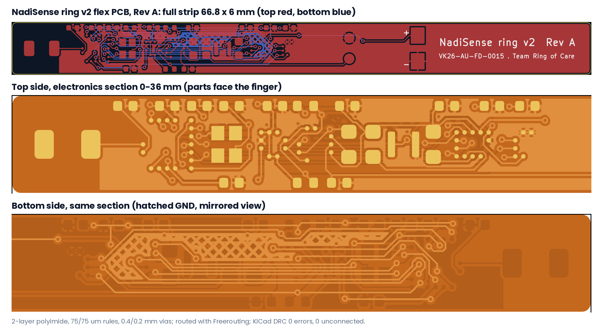

# NadiSense ring v2 flex PCB, Rev A (layout study)

| Item | Value |
|---|---|
| Board | 66.8 x 6.0 mm strip, wraps 330 deg at r = 11.6 mm inside the ring |
| Stackup | 2-layer polyimide flex: 25 um PI, 1/3 oz Cu, 25 um coverlay both sides, ENIG, ~0.11 mm |
| Stiffeners | 0.1 mm FR4/PI under the IC sections (outlines on User.1); bends only in the free sections, min radius 10 mm |
| Rules | 75 um track/space minimum, default 0.1 mm tracks, 0.4/0.2 mm vias, 0.15 mm copper-to-edge |
| Parts | 26, all on the top side (faces the finger); optics centred at 24.3 mm, under the optical window |
| Routing | 333 track segments, 44 vias, Freerouting 1.9.0; GND pour on top (solid) and bottom (cross-hatched for flexibility) |
| Antenna | Johanson 2450AT18A100 at the strip end, no copper pour under or beyond it |
| DRC (KiCad 7.0.11) | **0 violations, 0 unconnected pads** (`DRC.rpt`) |

## Files

- `NadiSense_flex.kicad_pcb` / `.kicad_pro` / `fp-lib-table` - KiCad 7 board
- `NadiSense.pretty/` - project footprints (ICs, photodiode, crystal, charge pads, battery tabs)
- `NadiSense_flex_gerbers.zip`, `fab/` - Gerbers, Excellon drill + maps, pick-and-place, BOM
- `NadiSense_flex_top.pdf`, `NadiSense_flex_bottom.pdf` - layer plots
- `pcb_gen.py`, `route_import.py`, `drc.py`, `run_all.sh` - the scripts that build, route and check the board

## Layout, left to right

Chip antenna (3.4 mm) - nRF52840 (9.6) - 32 MHz crystal (13.3, moved next to the SoC; the CAD renders still show
it further along) - LIS2DW12 (16.2) - BQ25120A + 2.2 uH inductor (18.8, 20.9) - red LED, photodiode, IR LED
(22.4, 24.3, 26.15) - MAX86141 (28.6) - TMP117 (32.0) - charge pads (38.9) - Li-Po tabs (46.8) - free section
behind the cell.

## Before fabrication (open items)

1. **IC land patterns are simplified.** U1-U5 use the simplified schematic pin numbers on a 0.5 mm grid inside the
   real package outlines. Replace them with the manufacturer land patterns (nRF52840 WLCSP needs 0.35 mm-pitch
   via-in-pad / HDI flex), give the symbols the real ball map, and re-route.
2. Add the nRF52840 RF matching network and tune the antenna feed once the ring is potted.
3. Confirm stiffener, coverlay openings and bend zones with the flex fab.
4. Electrical check after re-route: ERC on the updated schematic, then DRC with the fab's rule file.
