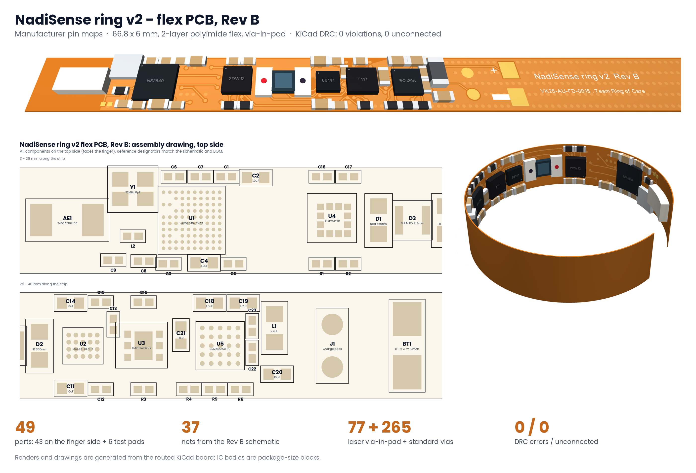

# NadiSense ring v2 - schematic + flex PCB, Rev B

Rev B replaces the Stage 2 simplified schematic (`../kicad/`) and the Rev A layout study. Every IC now uses its
manufacturer pin / ball map and the support parts its data sheet calls for, and the flex PCB is routed against
those real footprints.

| Item | Rev B |
|---|---|
| Board | 66.8 x 6.0 mm strip, wraps 330 deg at r = 11.6 mm inside the ring; optics centred at 24.3 mm under the window |
| Stackup | 2-layer polyimide flex: 25 um PI, 12 um Cu + plating, 25 um coverlay both sides, ENIG, ~0.11 mm |
| Vias | 77 laser vias 0.2/0.1 mm in the BGA pads (filled + capped, VIPPO); 265 routing / ground-stitching vias 0.35/0.15 mm |
| Rules | 75 um track / 75 um space, 0.15 mm copper-to-edge, 0.2 mm hole-to-hole |
| Pours | GND top (solid); bottom solid under the stiffened IC sections, cross-hatched in the bend sections |
| Parts | 43 on the top (finger) side, 6 test pads on the bottom; 49 total, 37 nets |
| Checks | KiCad 7.0.11 DRC **0 violations, 0 unconnected** (`DRC.rpt`); board pads vs schematic **0 mismatches** (`verify_pcb.py`); schematic netlist vs design **0 problems** (`verify_net.py`) |

## Power architecture (changed from Stage 2)

The BQ25120A buck output (SYS) is the single **1.8 V rail** for every IC. The nRF52840 runs in normal-voltage
mode (VDD = VDDH = 1.8 V, internal LDOs), so no 3.3 V rail is needed. The LEDs run from VBAT through the
MAX86141 drivers. The Stage 2 deck and report describe a 3.3 V buck feeding the nRF52840 regulator; Rev B
simplifies this.

## Parts and pin maps

| Ref | Part | Package / footprint | Pin-map source |
|---|---|---|---|
| U1 | nRF52840-CKAA | WLCSP-94, 0.35 mm pitch | Nordic nRF52840 PS, "Pin assignments - WLCSP" |
| U2 | MAX86141ENP+ | WLP-20 (5 x 4), 0.4 mm | ADI MAX86140/86141 data sheet, bump configuration |
| U3 | TMP117AIDRVR | WSON-6 2 x 2 mm + pad | TI TMP117 data sheet, pin functions |
| U4 | LIS2DW12TR | LGA-12 2 x 2 mm | ST LIS2DW12 data sheet, pin description |
| U5 | BQ25120AYFPR | DSBGA-25 (5 x 5), 0.5 mm | TI BQ25120A data sheet, pin configuration |

nRF52840 signal map: SPI SCK C10 (P0.04), MOSI D10 (P0.05), MISO E10 (P0.08), AFE_CS F10 (P1.09), AFE_INT G10
(P0.12); I2C SDA B10 (P0.01), SCL K7 (P0.15); ACC_INT A6 (P0.28), TEMP_ALRT K3 (P0.22), CHG_INT K2 (P0.25),
CHG_CD A7 (P0.30); nRESET K6; SWD J2/H2. Unused P0.29 (C7) is tied to GND to link the fenced-in VSS ball B7.
I2C addresses: TMP117 0x48, LIS2DW12 0x18, BQ25120A 0x6A.

## Layout, left to right

Chip antenna AE1 (copper keep-out) - pi-match C8/L2/C9 and 32 MHz crystal Y1 - nRF52840 U1 with decoupling -
LIS2DW12 U4 + I2C pull-ups - red LED D1, photodiode D3, IR LED D2 (optical window) - MAX86141 U2 - TMP117 U3 -
BQ25120A U5 with L1 and its capacitors / set resistors - charge pads J1 - Li-Po tabs BT1 - free strip behind the cell.
Bottom side: programming pads TP1 SWDIO, TP2 SWDCLK, TP3 nRESET, TP4 +1V8, TP5 GND next to the SoC (needs a
cut-out in the stiffener) and TP6 MR by the charger.

## Files

| File | What it is |
|---|---|
| `NadiSense_ring_v2_revB.kicad_sch` / `.kicad_pcb` / `.kicad_pro` | KiCad 7 project (open the `.kicad_pro`) |
| `NadiSense.kicad_sym`, `NadiSense.pretty/` | project symbols and footprints (IC land patterns, test pads, contacts) |
| `NadiSense_ring_v2_revB_schematic.pdf` | schematic |
| `NadiSense_ring_v2_revB_top.pdf`, `_bottom.pdf` | layer plots with the board outline and stiffeners |
| `NadiSense_ring_v2_revB_gerbers.zip`, `fab/` | Gerbers, Excellon drill + maps, pick-and-place, BOM |
| `images/` | overview, 3D flat + ring renders, routing view, assembly drawings, layer views |
| `DRC.rpt` | final design-rule check |
| `design.py` | single source of truth: parts, values, footprints, pin maps, nets |

## How the board was built

1. `build_sch.py` writes the schematic from `design.py`; `kicad-cli sch export netlist`; `verify_net.py` checks it.
2. `build_pcb.py` writes the footprints, outline, rules, rule areas, placement and via-in-pad fan-out, and a Specctra DSN.
3. Freerouting 1.9.0 routes the DSN (`-mp 120`); `route_import.py --no-pour` imports the session.
4. `finish2.py` (two-layer A* router) completes nets the autorouter left open; autorouted GND tracks are removed
   because the pours carry ground.
5. `finalize.py` adds the pours and stitching vias; `gnd_ties.py` and `gnd_bridge.py` tie the inner BGA ground and
   any isolated pour island into the main ground; `setrules.py` keeps the flex rules in the project file.
6. `drc.py`, `verify_pcb.py` for the checks; `make_outputs.py`, `drawings.py`, `render3d.py` for the deliverables.

## Before fabrication (open items)

1. **Land patterns to confirm against the package drawings:** U1 against Nordic PS section 7.2.3 (0.35 mm pitch
   derived from the 3.544 x 3.607 mm body and 10 x 10 grid), U2 against ADI outline 21-100134 / AN1891, U4 pad-1
   orientation against ST's land pattern.
2. **Fab capability:** 0.35 mm-pitch WLCSP on flex needs laser via-in-pad (filled, capped) and 75 um lines; confirm
   with the flex vendor, or move to a 4-layer flex if they prefer.
3. **Values still to set:** R4 (ISET) and R5 (IPRETERM) per TI's equations (charge current is also set over I2C);
   C8/L2/C9 antenna match to be tuned on a VNA in the potted ring; nRF52840 decoupling values (C1 DEC1 100 nF, C2
   DEC4 1 uF, C3 DEC6 47 nF, C4/C5 VDD) to be checked against Nordic's CKAA reference circuit.
4. **Antenna:** it sits next to the cell end; check range in the finished ring.
5. **Not yet done:** signal-integrity/RF simulation, thermal check of the LED drive, and a review in the KiCad GUI.
